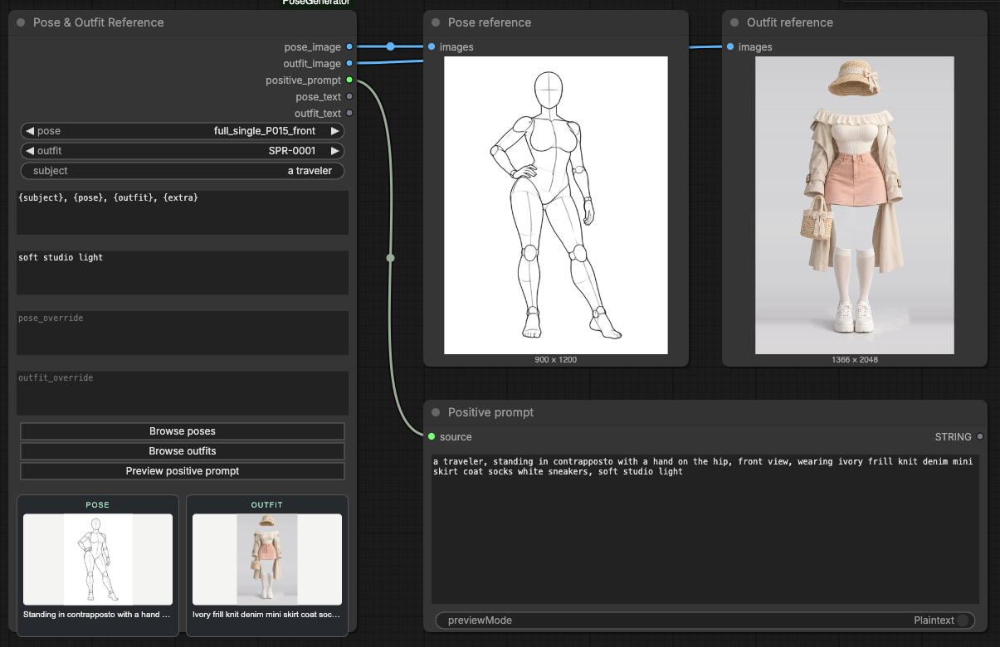
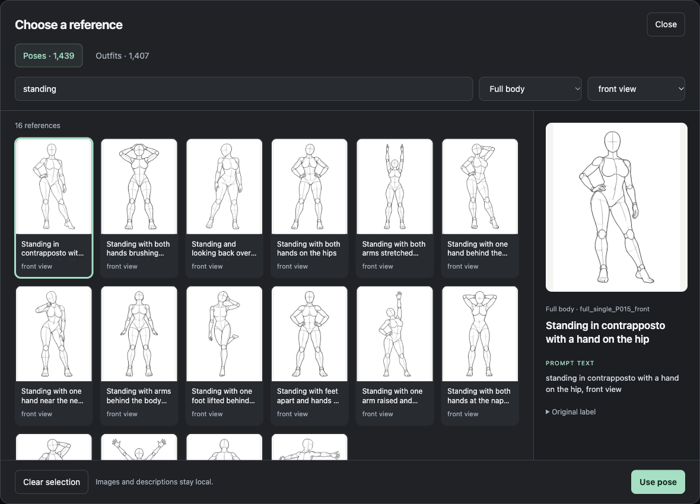

# Pose & Outfit Reference for ComfyUI


Pick a pose. Pick an outfit. Send the reference images and a ready-to-edit
positive prompt into your ComfyUI workflow.

## Credit where it belongs

**This is a ComfyUI adaptation of an existing gallery project. I did not create
the original gallery/tool or its reference assets, and I do not claim them as my
work.** My contribution is this small, independent ComfyUI integration.

Huge thanks to **[ギア / @giaaibusi](https://x.com/giaaibusi)** for the original
[pose](https://ai-pose-gallery.pages.dev/) and
[outfit](https://ai-costume-gallery.pages.dev/) galleries, and to
**[Anhao](https://github.com/anhao)** for the
[Chinese gallery project](https://github.com/anhao/ai-pose-gallery-zh), its
localization, organization, and generous work making these references easier to
explore. Their work is the reason this adaptation exists. Please visit the
original projects and give their creators the recognition and support they deserve.

The aim here is simply to make this wonderful reference workflow convenient
inside ComfyUI, with English descriptions and editable prompt text. This is an
independent adaptation, with no claim of endorsement or affiliation. If a creator
or rights holder would prefer this adaptation or any referenced material removed,
I will gladly take it down. [Full credits and image terms](THIRD_PARTY.md).

## What it does

- Switch pose galleries on the node and filter thumbnails by saved tags, category, camera angle, or search.
- Choose pose and outfit references independently.
- Compose a positive prompt with a simple text template.
- Override either description without changing its reference image.
- Preview images and prompt text directly on the canvas.
- Run locally without a model or an API key.

The node provides reference images; connect them to the image-conditioning nodes
you already use. It does not generate a finished image by itself.

<!-- Screenshot insertion point: docs/screenshots/workflow-overview.png.
     Captures stay local pending permission for the depicted gallery images.
     See docs/screenshots/README.md for captions and insertion snippets. -->

## Install

Clone this repository into `ComfyUI/custom_nodes/ComfyUI_PoseGenerator`. Using
ComfyUI's Python environment, install the requirements and restart ComfyUI:

```sh
python -m pip install -r requirements.txt
```

Add **Pose & Outfit Reference** from **image → reference**.

**Two pose galleries come with the pack:** **Instagram Poses** (28 poses) and **OF poses** (22 poses), each pose with a saved depth map. Both are mannequin drawings made with Pose Studio from the publisher's own photos. Pick them from the node's **Pose gallery** dropdown; no setup needed. Outfits are separate (below).

**94 outfits ship too**, in `assets/shipped/Outfits/`: original ghost-mannequin outfits in 15 styles, with tags by body zone, colour, fabric and season that you can filter by. [How to add outfits](docs/library.md#add-your-own-outfits).

**Bring references you have permission to use.** Put your images and a
`catalog.json` in `assets/gallery`, or point `POSE_GENERATOR_ASSETS` to your own
library folder. [Library setup and catalog example](docs/library.md).

The public source and registry package do **not** bundle the original gallery
images (poses or outfits). The original pose and outfit sites currently prohibit bulk downloading
and redistribution, including modified copies. Gallery distribution and automated
setup remain on hold pending the rights holder's permission. The local research
catalog contained 1,439 poses and 1,407 outfits; these are not included downloads.

## Use

1. Click **Browse poses** or **Browse outfits**, choose a thumbnail, then click
   **Use pose** or **Use outfit**.
2. Enter a **subject**, optional **extra** details, and any description overrides.
3. Click **Preview positive prompt** to inspect the composed text.
4. Connect the image outputs to your reference-image workflow and
   `positive_prompt` to **CLIP Text Encode (Prompt)** or your preferred encoder.
   Convert the encoder's text widget to an input if needed.

| Output | Type | Use |
| --- | --- | --- |
| `pose_image` | `IMAGE` | Selected pose at its source dimensions |
| `outfit_image` | `IMAGE` | Selected outfit at its source dimensions |
| `positive_prompt` | `STRING` | Composed text for your positive prompt |
| `pose_text` | `STRING` | Pose description on its own |
| `outfit_text` | `STRING` | Outfit description on its own |
| `picture_1` … `picture_4` | `IMAGE` | The subject photo, pose, outfit and location picture that exist, in prompt order |
| `width`, `height` | `INT` | Size of `picture_1` (0 without pictures) |

Choose **None** or **Clear selection** to omit a reference from the prompt.
An omitted image output is a black 1×1 placeholder; leave it unconnected.






## Edit a photo of a person

Connect a photo to the optional **subject_image** input to put that person in the
chosen pose and outfit with an image-edit model such as MiniMax H3 Image.

1. Wire `picture_1`, `picture_2`, `picture_3`, `picture_4` to the model's image 1, 2, 3, 4,
   in that order, and `positive_prompt` to its prompt. Wire them straight into the model:
   a missing reference leaves its output empty.
2. Wire `width` and `height` to the model's size inputs.

The node numbers the pictures and writes the prompt to match, so you never type
picture numbers yourself.

| Input | What it does |
| --- | --- |
| `picture_tag` | How the prompt names a picture. `<Picture {n}>` for MiniMax H3, `image {n}` for Qwen Edit, Kontext or Seedream. Empty gives a plain text prompt. |
| `edit_target` | Which picture is `picture_1`, the one the model edits. **Pose** keeps the drawing's pose, framing and camera angle. **Subject** keeps the photo's scene and is looser on the pose. |
| `location_image` | Optional picture of a place. The result is set there (setting, background and lighting, not the people in it). It is the last numbered picture. |
| `location` | A connected `location_image` takes over from the subject photo. Otherwise, with the pose as the edited picture: **From the subject photo** takes the photo's place and lighting, **Plain studio** gives a white background and the tightest pose match, **Custom** leaves it to `extra`. |
| `megapixels` | Resizes `picture_1` to about this area. 0 leaves it as it is. |
| `reference_text` | Adds the pose and outfit descriptions alongside the pictures, or points at the pictures only. |

With no outfit selected, the person keeps the clothes from their photo.
[MiniMax H3 Image example](examples/README.md#minimax-h3-image-edit).

## Prompt templates

```text
{edit} {subject}, {pose}, {outfit}, {location}, {extra}
```

For example, with your own descriptions:

```text
a traveler, standing with one hand on the hip, front view, wearing a blue jacket, soft studio light
```

Supported fields: `{edit}`, `{subject}`, `{pose}`, `{outfit}`, `{location}`, `{extra}`,
`{pose_name}`, `{outfit_name}`, and `{angle}`. `{edit}` and `{location}` are empty
unless `picture_tag` is set and there is a picture to refer to. A template that leaves
them out still gets both: the opener at the start and the location before `{extra}`.
Set `location` to **Custom** to leave the location out. Outfit text already begins with “wearing”.
Use `pose_override` and `outfit_override` to refine the text.

Prompt weights such as `({pose}:1.2)` and line breaks work. Use `{{` and `}}` for
literal braces. Templates perform literal substitution; they do not execute code.

## Example workflow

[Download the four-node preview workflow](examples/pose-outfit-preview.json),
then drop it onto ComfyUI. Select references from your own installed library and
click **Run** to see both images and the composed text. No checkpoint, GPU, or
additional node packs are required. [Example instructions](examples/README.md).

## Documentation

- [Local libraries and optional WebP optimization](docs/library.md)
- [Registry publishing and GitHub social preview setup](docs/releasing.md)
- [Development and pre-upload checks](docs/development.md)
- [Credits, source terms, and removal requests](THIRD_PARTY.md)

The integration software is [MIT licensed](LICENSE). That license grants no
rights to the original gallery images, metadata, or derived descriptions.
